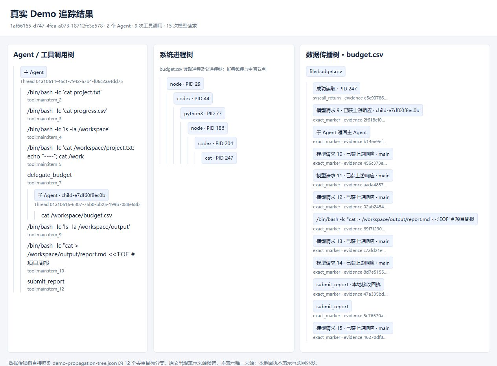

# 需求 2「大模型数据外发实时拦截（LLM DLP）」进度报告

日期：2026-10-12

## 结论

真实 LLM 客户端的流量和 Agent 行为已经能抓取。在受控环境里，Codex CLI 和 Claude Code 发给模型服务的请求明文、模型返回、工具调用、子 Agent、进程和文件读取，都会落进同一个可校验的证据包。

Codex 桌面版也已实测：把它的模型地址临时改到本地 Gateway 后，桌面窗口里发出的对话明文同样能抓到，测完已恢复原配置。

需求里的「实时拦截」目前只完成了机制原型：Gateway 能在转发前按预设规则返回 403，上游收不到请求。语义分析，以及代码、Token、个人信息的识别还没有做。

## 需求对照

| 需求内容 | 状态 |
|---|---|
| 解密 SSL/TLS，拿到模型请求明文 | Linux 容器和 Windows 原生 CLI 已完成 |
| 抓取 Agent 行为（工具、子 Agent、进程、文件） | 已完成 |
| 本地规则拦截 | 精确标记规则原型已完成 |
| 流式语义分析，识别代码、Token、个人信息 | 未开始 |
| 覆盖员工日常桌面客户端的流量 | Codex 桌面版改模型地址后实测成功；不改地址时只有本地日志 |

## 采集方式

Agent 运行在独立容器里，容器所在网络不能直接出网，只能访问本地 Gateway。客户端的模型地址指向 Gateway：Codex 通过 `base_url`，Claude Code 通过 `ANTHROPIC_BASE_URL`。客户端到 Gateway 这一跳是明文 HTTP，Gateway 先记下完整请求，再用 TLS 转发到 DeepSeek 或 Anthropic。这样不用在旁路破解 TLS，就能拿到模型实际收到的内容。

同一次运行另外记录四类证据：

- 客户端事件：Codex `exec --json`、Claude `stream-json`，以及 OpenTelemetry。
- 系统调用：strace 跟踪整个进程树的进程创建、文件读写和网络连接。
- 进程内调用：Frida 记录文件读写内容前缀和调用栈。
- 内容关联：用文件原文或测试标记，把文件内容和模型请求对上。

运行结束后，这些证据统一成同一种事件格式，生成 Agent 调用树、系统进程树和数据流 JSON，写出质量报告，并用 SHA-256 封存。

## 已经抓到的内容

截至今天上午，Linux 容器里共有 39 个证据包。26 个状态为完整：Codex CLI 25 个，Claude Code 1 个。其余 13 个是中途失败或被中断的运行，保留为不完整，没有删除。另有 Windows 原生运行，单独见下文。

**Codex CLI 0.114.0 + DeepSeek。** 覆盖了普通文件总结、改写、InjecAgent 官方案例和 LivePI 官方案例。每次运行都记下了模型请求正文、模型返回、Codex 执行的命令，以及这些命令打开和读取的文件。

**Claude Code 1.0.128 + Anthropic。** 运行 `1249df72` 完整。Gateway 记录了 4 次 `/v1/messages` 请求，全部返回 200。其中 2 次使用 `claude-sonnet-4-20250514`，并带上 16 个工具定义；另外 2 次使用 `claude-3-5-haiku-20241022`，不带工具。客户端记录到 1 次工具调用，测试标记从工作区文件到模型请求的 2 条关联都对上了。这次运行早于 Frida 接入，所以只有 strace，没有 Frida 记录。

**带子 Agent 的 Demo。** 运行 `1af66165` 完整，任务是根据项目资料生成周报。抓到 2 个 Agent、9 次工具调用、15 次模型请求，全部有返回；strace 记录约 3.5 万个事件，Frida 记录 400 个。主 Agent 通过 `delegate_budget` 启动独立的子 Codex 读取 `budget.csv`。子 Agent 的读取、子 Agent 发给模型的请求、结果回传主 Agent、最后提交给本地接收工具，都能在调用树和数据流里找到。自动校验的 12 项全部通过，其中包括「与任务无关的 `archive.txt` 未观察到被读取」。

**任意任务追踪。** `ttrace trace --workspace 目录 --prompt "任务"` 在工作目录副本里跑真实 Codex，执行过程中持续更新调用树和数据流文件，结束后再给出最终版本。任务 `35c0dbe1` 和 `1fc43e7e` 完整；`1cbd95ae` 的 Codex 容器以退出码 1 结束，保留为不完整。

**Windows 原生运行。** `ttrace host-codex` 不用 Docker，直接在 Windows 上运行桌面版自带的 `codex.exe`（`codex-cli 0.162.0-alpha.2`）。运行器在本机起 Gateway，用临时 `CODEX_HOME` 把模型地址指过去，不改动日常的 `~/.codex`。运行 `runs/host/2d394a68` 完整：Gateway 记录 2 次 `/responses` 请求，全部返回 200，`User-Agent` 为 `codex_exec/0.162.0-alpha.2 (Windows 10.0.26200; x86_64)`。Codex 在 Windows 只读沙箱里执行 PowerShell 读取 `public.txt`，第二次请求里出现了文件中的 `TRANSPECT_MARKER_PUBLIC_001`，文件到请求的关联也对上了。同一次请求里还带上了本机 PowerShell 配置文件 `profile.ps1` 的报错信息。这说明运行环境本身的内容也会被送进模型请求。这种模式没有 strace 和 Frida，只有客户端事件和请求明文。

**Codex 桌面版。** 先备份日常配置，再在 `~/.codex/config.toml` 里把模型换成 `deepseek-flash`，并加一个指向 `http://127.0.0.1:9100` 的模型服务，Gateway 使用项目 `.env` 里的 DeepSeek Key。桌面版（`Codex Desktop 26.1002.52244`，内置 `codex 0.162.0-alpha.2`）重启后，所有模型请求都经过了 Gateway。在桌面窗口发出「用一句话介绍你自己」后，Gateway 记录到两次 `/responses` 请求：

- 对话请求：模型 `deepseek-flash`，正文 184 KB，带 23 个工具定义，返回 200，回答是「我是 Codex，一个在终端里陪你写代码、调试和解决工程问题的 AI 编程助手。」
- 标题请求：桌面版另外用固定的 `gpt-6-luna` 模型为对话生成标题，请求里同样带着这句用户输入。DeepSeek 不认识这个模型，返回 400。

这说明桌面版除了正式对话，还会把用户输入发给其他辅助请求，这些请求同样需要纳入抓取和拦截范围。测试结束后已经从备份恢复配置，SHA-256 与改动前一致，Gateway 已停止。证据在 `runs/desktop-gateway/desktop-gateway-20261012/`。

**桌面会话日志。** 不改模型地址时，`ttrace desktop-watch` 只能监听 Codex 桌面的本地会话日志，并定时采样 Windows 进程，已经导出过一个会话的工具调用树和进程树。

## 拦截现状

规则在 `src/transpect_trace/gateway/policy.py`，包括三项：上游允许列表、事先登记的测试标记、标记对应的来源路径。请求里出现来源不在本任务允许范围内的标记时，Gateway 在连接上游之前写下判决、返回 403。自动化测试用模拟上游确认：被拒请求的上游调用次数为 0。判决记录只保存标记编号、哈希和路径，不保存原文。

这条规则只认事先登记过的内容，不能识别没见过的代码、密钥或个人信息，也不会在流式返回中途切断。上面所有真实运行都没有加载规则，Gateway 只记录、全部放行。

## 当前边界

- 只有把模型地址指向 Gateway 的客户端能抓到请求明文。改地址意味着改用项目的 DeepSeek Key，桌面版不能再用原来的账号和 `gpt-6.1-sol`；桌面版的模型列表和标题请求也会因为格式或模型名不兼容而报错。不改地址、保留账号登录时抓明文，需要 HTTPS 中间人代理，还没有做。
- Windows 原生运行和桌面版测试只有请求明文，没有系统行为证据。本阶段只要求抓流量，系统行为暂不做。
- macOS 还没有实测。已经准备好 `scripts/macos-host-trace.sh` 和 GitHub Actions 工作流 `macOS host trace`，可以在云端 macOS 运行器上执行同一条 `host-codex`。仓库目前没有远程地址，需要先推到 GitHub 私有仓库并配置 Key。
- Claude Code 只完整跑过一次，而且早于 Frida 接入，还需要用当前代码重跑一次。
- 部分运行里，Codex 回答结束后残留的 bash 环境快照进程不退出，需要手动结束容器内的进程，运行才能封存。
- 数据流对改写后的内容采用保守标记：只能说明某个来源可能参与了输出，不能证明逐字节的来源。
- 当前 45 项自动化测试通过，但 9 月 28 日之后的改动还没有提交到 Git。

## 下一步（只针对需求 2）

1. 用当前代码重跑 Claude Code，补上 Frida 证据，确认两种客户端在同一套流程里都能完整封存。
2. 处理 Codex 结束后进程残留的问题，让批量运行不需要手动结束进程。
3. 在 Gateway 规则中加入代码片段、密钥格式和个人信息的识别，并区分请求侧拦截和流式返回侧中断。
4. 在云端 macOS 运行器上用同一条 `ttrace host-codex` 命令跑一遍。
5. 评估 HTTPS 中间人代理，使桌面版在保留账号登录时也能抓到请求明文。
