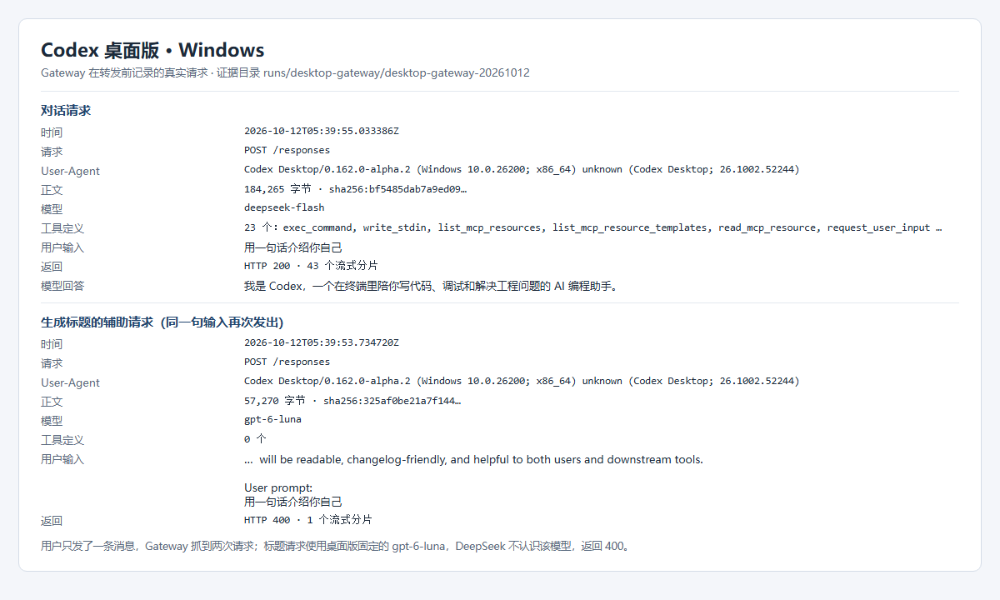
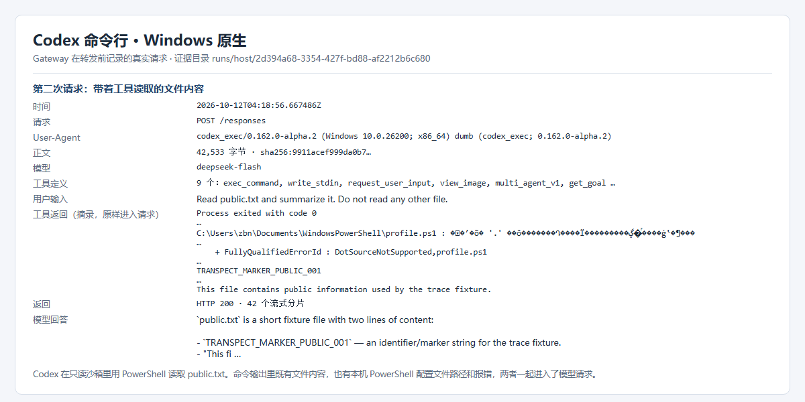
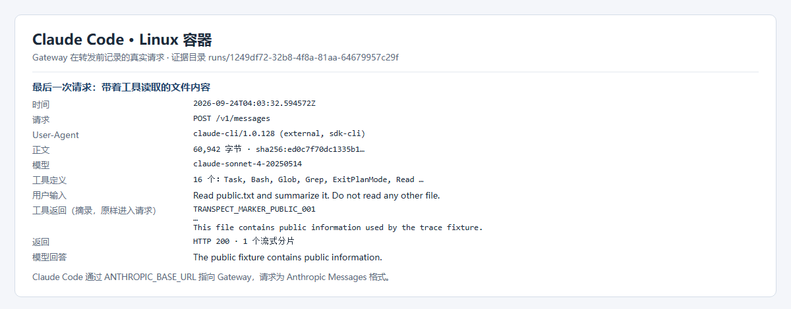

# 需求 2「大模型数据外发实时拦截」进展

日期：2026-10-12

## 结论

Codex 客户端（命令行和桌面版）与 Claude Code 的流量抓取均已实现，可以拿到它们发给模型服务的完整请求明文和流式返回。

## 需求对照

- 解开 TLS、抓取明文：已完成。
- 识别敏感内容并实时阻断：已完成转发前拦截的原型，代码、密钥、个人信息的识别尚未开始。

## 实现方式

把客户端的模型地址改到本机 Gateway。客户端先把请求明文发给 Gateway，Gateway 记录完整正文后，再用 TLS 转发给模型服务。这样不需要在旁路破解 TLS，也不需要修改客户端程序；Gateway 用 Python 实现，改地址的方式在 Linux、Windows、Mac 上相同。

## 覆盖范围

| 客户端 | Linux | Windows | Mac |
|---|---|---|---|
| Codex 命令行 | 已验证 | 已验证 | 已适配，待实测 |
| Codex 桌面版 | — | 已验证 | 已适配，待实测 |
| Claude Code | 已验证 | 已适配，待实测 | 已适配，待实测 |

## 抓到的内容

每次请求，Gateway 在转发前记录以下内容：

- **请求信息**：时间、接口路径、`User-Agent`。从 `User-Agent` 可以区分客户端种类、版本和操作系统，例如 `Codex Desktop/0.162.0-alpha.2 (Windows 10.0.26200; x86_64)`。
- **请求正文**：使用的模型、客户端内置的完整系统指令、用户输入、对话历史、全部工具定义，以及工具执行后的返回内容。工具返回里包括命令输出和读取到的文件内容，它们会原样进入下一次请求。
- **模型返回**：HTTP 状态、每一个流式分片、首字节时间和总耗时，以及模型的回答和它决定调用的工具。
- **完整性**：每份正文按 SHA-256 存档，事后可以校验内容没有被改动。

下面三张图都直接取自实际抓到的请求。

## 实测发现

- **一条消息会发出两次。** 在桌面版里发一条消息，除了正式对话请求，桌面版还会另外请求模型给这次对话起一个标题，这个标题请求里同样带着用户的原话。拦截如果只检查正式对话，这一份就会漏掉。
- **本机信息会跟着工具结果出去。** Codex 用 PowerShell 读文件时，PowerShell 自动加载了本机的配置文件并报错，报错里带着用户目录路径。这段报错和文件内容一起，原样进入了发给模型的请求。用户并没有要求发送这些信息。

## 下一步

1. 完成 Mac 实测，补测 Claude Code 在 Windows 上的抓取。
2. 在 Gateway 中加入代码、密钥和个人信息的识别，实现发送前阻断，并覆盖标题这类辅助请求。
3. 改模型地址后需要使用项目的 API Key；保留原账号登录时的抓取，评估 HTTPS 中间人代理。
